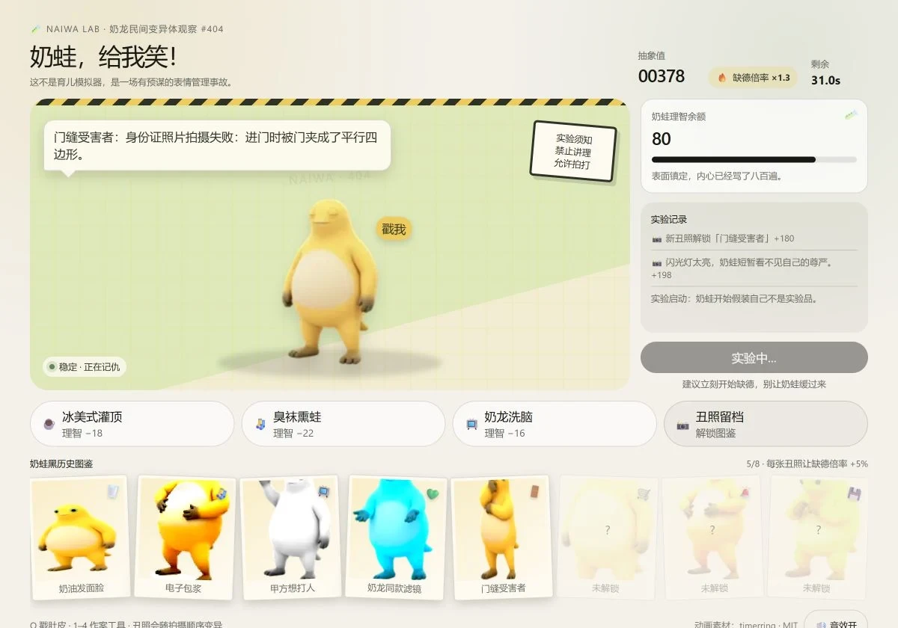

# Milk Frog: Make Me Laugh!



A fast, chaotic, 40-second browser game about a round yellow milk frog, questionable experiments, and an increasingly cursed photo album.

This is not a pet simulator. It is a consent-free photoshoot with a score multiplier.

## Features

- Animated Milk Frog character with several expressive poses.
- Four prank tools and a clickable frog with combo scoring.
- Eight unlockable “blackmail photo” forms, each with a permanent +5% score bonus.
- Random disaster events with branching choices.
- A sanity meter that triggers a three-frog meltdown at zero.
- Tiny synthesized sound effects, sound toggle, and keyboard controls.
- Responsive layout for desktop and mobile.
- No frameworks, build dependencies, analytics, or network calls at runtime.
- Best score and unlocked photos are saved locally in the browser.

## Play

The repository includes a generated `index.html`, so it can be hosted as a static site.

```bash
npm start
```

Then open <http://127.0.0.1:8000>.

No `npm install` step is required.

## Controls

| Input | Action |
| --- | --- |
| Click the frog | Poke its belly |
| `Q` | Poke its belly with the keyboard |
| `1` | Iced coffee |
| `2` | Stinky sock |
| `3` | Nailong video |
| `4` | Cursed photo |

Chain actions quickly to raise the mischief multiplier. Taking photos unlocks the next hidden form in the photo album. Select any unlocked photo to inspect it.

## Build

The playable game lives in `src/game.html`. The build script wraps it in the standalone page shell and switches the animation asset to the local copy.

```bash
npm run build
npm run check
```

`npm run build` writes `index.html`.

## Project Layout

```text
.
├── assets/
│   └── naifrog-spritesheet.webp
├── docs/
│   └── screenshot.webp
├── scripts/
│   ├── build.mjs
│   ├── check.mjs
│   └── serve.mjs
├── src/
│   └── game.html
├── index.html
├── LICENSE
├── README.md
└── THIRD_PARTY_NOTICES.md
```

## Privacy and Saves

The game does not send data anywhere. It stores the local best score and unlocked photo forms in `localStorage`:

- `naifrog-best-score-v1`
- `naifrog-blackmail-v1`

Clearing site data resets both.

## Contributing

See [CONTRIBUTING.md](CONTRIBUTING.md). Keep additions playful, surprising, and harmless. The game can be gross, weird, or petty, but it should never target real people or encourage dangerous behavior.

## Credits and License

The game code is released under the [MIT License](LICENSE).

The Milk Frog animation frames are adapted from timerring's Naifrog desktop-pet animation set and are used under the MIT License. The full third-party notice is in [THIRD_PARTY_NOTICES.md](THIRD_PARTY_NOTICES.md).

Milk Frog is an unofficial fan-made internet character related to Nailong. This project is not affiliated with or endorsed by the original rights holders. The included artwork remains subject to any rights held by its original creators.
